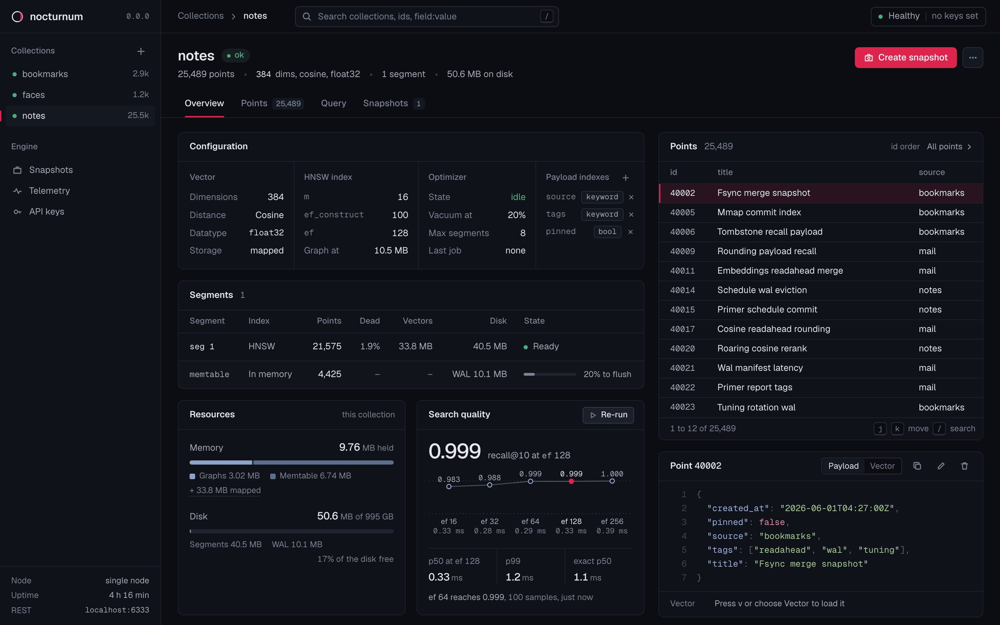
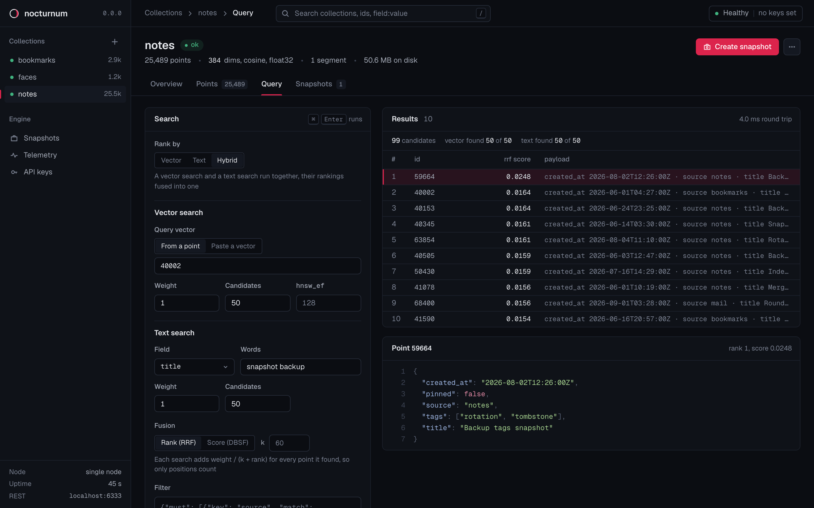

<h1></h1>

[](LICENSE)
[](Cargo.toml)
[](console/README.md)
[](#run-it)
[](#roadmap)

A vector database for one small box at home, written in Rust, that stores embeddings with JSON payloads and finds the ones closest to a query, filtered on those payloads.

Think of a self-hosted take on [Qdrant](https://qdrant.tech/), rebuilt from scratch as one binary with the web console built in and nothing held back for a paid tier.



## What it does

- **Search:** exact search for small or tightly filtered sets and HNSW graphs for large ones, with filters planned against payload indexes.
- **Text search:** BM25 keyword ranking over a payload field, with its statistics counted over the live collection on every query, so they never go stale.
- **Sparse vectors:** an optional sparse vector per point, such as SPLADE output, searched by dot product with optional IDF weighting.
- **Hybrid search:** one query runs vector, text and sparse searches together and fuses their rankings with reciprocal rank or score-distribution fusion, reporting how many candidates each search found.
- **Filters:** `must`, `should`, `must_not` and `min_should`, with match, any, except, range, null and emptiness checks, value counts, ids and nested arrays, and keyword, integer, float and bool payload indexes to speed them up, plus text indexes for keyword ranking.
- **Durability:** each point write says how sure the answer has to be, durable on disk by default, with crash tests that kill the process mid-write behind every level and power-loss tests still to come.
- **Backups:** snapshots with checksums that restore while the server keeps running, and a cron schedule per collection that keeps the newest N.
- **Search quality:** a recall check that runs graph search against exact search at several beam widths, so you can see what a faster setting costs.
- **Access:** admin and read-only keys, loopback by default, and protection against DNS rebinding and cross-site requests when no keys are set.
- **Operations:** `/livez`, `/readyz`, Prometheus `/metrics`, engine status per collection, a time limit on searches and a cap on reads running at once, so a burst of searches leaves threads free for writes, and a clean shutdown on SIGINT or SIGTERM.

The engine, the REST server and the console run end to end, with 306 tests passing on macOS and Linux, crash tests included.

The console comes with the binary on the same port, for browsing collections, points and payloads, running queries, checking search quality, taking, restoring and scheduling snapshots, watching the engine work and setting keys, with `j` and `k` stepping through points beside their JSON.

Its query page ranks by a vector, from a stored point or a pasted one, by words over a text index, or by both at once with their rankings fused, and can run exact search alongside a vector search to show how many of the results match.



## How you use it

nocturnum stores and searches vectors, and making them is the job of an embedding model, such as one running in [Ollama](https://ollama.com/) or a hosted embedding API.

1. Create a collection with the vector size and distance your model uses, such as 768 dimensions compared by cosine.
2. For each document, ask the model for its vector and upsert it with the text and any metadata as the payload.
3. To search, embed the question with the same model and send that vector, with a filter if you want one, and the closest points come back with their payloads.

With a good embedding model, a search for "renewing the proxy's certificate" finds a note called "caddy cert rotation", because the two mean the same thing even though they share no words.

Exact words matter too, such as an error code or a hostname, so a `text` index on the field holding a document's text lets a search rank by those words with BM25, and a hybrid query runs both searches at once and fuses the results.

That makes it the store behind agent memory, search over your notes, bookmarks or documents, matching new log errors against old incidents, or finding photos by description with an image model.

### Concepts

A **collection** is a named set of points that all share one vector size and one distance metric.

A **point** has an id, a vector, optionally a sparse vector, and a payload:

- the **id** is an unsigned 64-bit integer or a UUID,
- the **vector** is a list of floats of the collection's size,
- an optional **sparse vector** holds a few weighted dimensions out of a very large space, as `indices` and `values`,
- the **payload** is any JSON object up to 64 levels deep, used for filtering and returned with results.

**Distance** is one of `cosine`, `dot`, `euclid` or `manhattan`.
For `cosine` and `dot` the score is a similarity and higher is closer, while for `euclid` and `manhattan` it is a distance and lower is closer.

A **filter** narrows a search, scroll, count or bulk change to the points whose payload matches, and works on every field, while a **payload index** on a field makes those filters fast.

A **snapshot** is one tar file holding a whole collection, with its SHA-256 beside it, which can be downloaded or restored.

## How it fits together


- **The write-ahead log** takes every write first, in records with checksums, and recovery cuts off a torn record at its end.
- **The memtable** holds recent writes in RAM, and its only durable form is the log, which keeps the on-disk side simple: every segment file is written once and never changed.
- **A flush** writes the memtable out once it has taken 32 MiB of writes, as a new immutable segment with an HNSW graph once its vectors reach 10 MiB, built in a temporary directory and renamed into place, then publishes a new **manifest** listing it, and only then trims the log.
- **The optimizer** merges small segments once there are more than 8, and rewrites any segment where more than 20% of the rows are dead and safe to drop, building aside and swapping the manifest the same way, with its progress shown in the console.
- **Reads** work from a snapshot of the memtable and the segment list that costs a few pointer copies to take, where the newest copy of a point wins, so a long search or scroll never holds a write back, and a write that lands meanwhile copies only what it changes.
- **Payload indexes** are built in RAM for each segment as it is written or opened, so they never need logging or repair.
- **Search** asks each segment for its best matches and merges them, and the tests check HNSW results against exact search.

| Path | What |
|---|---|
| `crates/nocturnum-core` | shared types: point ids, vectors and distances, payloads, filters, errors |
| `crates/nocturnum-storage` | the log, memtable, segments, manifest, optimizer and snapshots |
| `crates/nocturnum-index` | exact and HNSW vector indexes, payload indexes |
| `crates/nocturnum-query` | collections: filter planning, search, scroll, count and the recall check across segments |
| `crates/nocturnum-api` | the REST server, auth, metrics and the collection registry |
| `crates/nocturnum-server` | the `nocturnum` binary: config, startup, shutdown and the embedded console |
| `console/` | the SvelteKit web console, built to static files that the binary embeds |
| `docs/` | the API reference, decision records, specs and the study of Qdrant this started from |

## Run it

You need Rust 1.99 or newer, which `rustup` installs from `rust-toolchain.toml` on the first build, and Node 22.17 or newer to build the web console.

```bash
git clone https://git.nocfa.net/NocFA/nocturnum.git
cd nocturnum
npm --prefix console ci && npm --prefix console run build
cargo run --release -p nocturnum-server -- --data ./data
```

The server listens on `http://127.0.0.1:6333` and keeps everything under `./data`, and the web console is at that same address in a browser.
A binary built without the console still serves the whole API, and says at startup that the console is missing.

```bash
curl -s localhost:6333/readyz; echo
```

```json
{"status":"ready"}
```

The `echo` adds the newline the response leaves out, without it zsh shows a `%` at the end of the line.

## A tour of the API

These run against the server from [Run it](#run-it), and the responses shown are real ones.
Request bodies must be sent with `Content-Type: application/json`, so a small shell helper saves typing:

```bash
j() { curl -s -H 'Content-Type: application/json' "$@"; echo; }
```

Create a collection of 3-dimensional vectors compared by cosine:

```bash
j -X PUT localhost:6333/v1/collections/notes \
  -d '{"vectors": {"dim": 3, "distance": "cosine"}}'
```

```json
{"created":true}
```

Add three points, each with a payload:

```bash
j -X PUT localhost:6333/v1/collections/notes/points -d '{"points": [
  {"id": 1, "vector": [0.1, 0.9, 0.2], "payload": {"title": "fox", "tags": ["red"], "price": 12.5}},
  {"id": 2, "vector": [0.8, 0.1, 0.1], "payload": {"title": "owl", "tags": ["brown"], "price": 30}},
  {"id": 3, "vector": [0.2, 0.8, 0.3], "payload": {"title": "cardinal", "tags": ["red"], "price": 8}}
]}'
```

```json
{"seq":1,"ack":"durable"}
```

`seq` is the write's place in the log, and `durable` means it was on disk before the server answered.

Find the two closest points:

```bash
j -X POST localhost:6333/v1/collections/notes/points/search \
  -d '{"vector": [0.1, 0.8, 0.3], "limit": 2}'
```

```json
{"points":[{"id":3,"score":0.99357355,"payload":{"price":8,"tags":["red"],"title":"cardinal"}},{"id":1,"score":0.9902891,"payload":{"price":12.5,"tags":["red"],"title":"fox"}}]}
```

Search only red things under 10, returning just the title:

```bash
j -X POST localhost:6333/v1/collections/notes/points/search -d '{
  "vector": [0.1, 0.8, 0.3],
  "filter": {"must": [{"key": "tags", "match": "red"}, {"key": "price", "range": {"lt": 10}}]},
  "with_payload": {"include": ["title"]}
}'
```

```json
{"points":[{"id":3,"score":0.99357355,"payload":{"title":"cardinal"}}]}
```

Count, page through and fetch points:

```bash
j -X POST localhost:6333/v1/collections/notes/points/count \
  -d '{"filter": {"must": [{"key": "tags", "match": "red"}]}}'
j -X POST localhost:6333/v1/collections/notes/points/scroll -d '{"limit": 2}'
j -X POST localhost:6333/v1/collections/notes/points/get -d '{"ids": [2]}'
```

```json
{"count":2}
{"points":[{"id":1,"payload":{"price":12.5,"tags":["red"],"title":"fox"}},{"id":2,"payload":{"price":30,"tags":["brown"],"title":"owl"}}],"next":2}
{"points":[{"id":2,"payload":{"price":30,"tags":["brown"],"title":"owl"}}]}
```

Scroll's `next` goes into `"after"` on the following request, and is `null` on the last page.

Index a field you filter on often, then look at the collection:

```bash
j -X PUT localhost:6333/v1/collections/notes/indexes -d '{"path": "tags", "kind": "keyword"}'
j localhost:6333/v1/collections/notes
```

```json
{"created":true}
{"name":"notes","vectors":{"dim":3,"distance":"cosine"},"points":3,"segments":0,"indexes":[{"path":"tags","kind":"keyword"}]}
```

`segments` is 0 because these points still sit in the memtable, which is flushed to a segment once it has taken 32 MiB of writes.

Give the titles a text index, then rank by words, alone or fused with a vector search:

```bash
j -X PUT localhost:6333/v1/collections/notes/indexes -d '{"path": "title", "kind": "text"}'
j -X POST localhost:6333/v1/collections/notes/points/search -d '{"text": {"field": "title", "query": "owl"}}'
j -X POST localhost:6333/v1/collections/notes/points/query -d '{
  "prefetch": [
    {"vector": [0.1, 0.8, 0.3]},
    {"text": {"field": "title", "query": "owl"}}
  ],
  "limit": 3,
  "with_payload": {"include": ["title"]}
}'
```

```json
{"created":true}
{"points":[{"id":2,"score":0.98082924,"payload":{"price":30,"tags":["brown"],"title":"owl"}}]}
{"points":[{"id":2,"score":0.032266457,"payload":{"title":"owl"}},{"id":3,"score":0.016393442,"payload":{"title":"cardinal"}},{"id":1,"score":0.016129032,"payload":{"title":"fox"}}],"candidates":{"pool":3,"sources":[{"limit":3,"found":3},{"limit":3,"found":1}]}}
```

The vector search ranks the owl last, and the word match lifts it to the top of the fused list, while `candidates` says how many points each search found for fusion to choose from.

Ask what the engine holds right now, and how much of the true top results graph search finds at a few beam widths:

```bash
j localhost:6333/v1/collections/notes/status
j -X POST localhost:6333/v1/collections/notes/points/recall -d '{"samples": 3, "limit": 2, "hnsw_ef": [2, 8]}'
```

```json
{"disk_bytes":267,"failure":null,"index":{"default_ef":128,"ef_construct":100,"m":16,"min_bytes":10485760},"memtable":{"bytes":223,"entries":3,"flush_bytes":33554432,"frozen_entries":0},"optimizer":{"enabled":true,"last":null,"last_error":null,"max_segments":8,"progress":null,"running":null,"vacuum_ratio":0.2},"points":3,"segments":[],"wal":{"bytes":267,"fsyncs":1,"last_seq":1}}
{"exact":{"p50_ms":0.003,"p99_ms":0.011},"indexed_points":0,"limit":2,"points":3,"runs":[{"hnsw_ef":2,"p50_ms":0.003,"p99_ms":0.003,"recall":1.0},{"hnsw_ef":8,"p50_ms":0.003,"p99_ms":0.003,"recall":1.0}],"samples":3}
```

Recall is 1 here because no segment is big enough for a graph yet, so every search is exact.

Change payloads, delete points and take a snapshot:

```bash
j -X POST localhost:6333/v1/collections/notes/points/payload/set -d '{"ids": [2], "payload": {"price": 25}}'
j -X POST localhost:6333/v1/collections/notes/points/delete -d '{"filter": {"must": [{"key": "tags", "match": "brown"}]}}'
j -X POST localhost:6333/v1/collections/notes/snapshots
```

Mistakes come back as a status code with an error naming the problem and, where it can, the field:

```json
{"error":{"at":"vector","code":"invalid_vector","message":"vector has 2 dimensions, the collection expects 3"}}
```

Every endpoint, field, limit and error code is in [`docs/api/v1.md`](docs/api/v1.md).

## Writes and durability

Every point write takes `?ack=` to say how sure the answer has to be, and defaults to the safest.

| `ack` | The answer means | Lost on |
|---|---|---|
| `accepted` | checked and appended to the log buffer | a process crash or power loss |
| `applied` | appended to the log and applied, so reads see it | power loss before the next background sync, once a second by default |
| `durable` (default) | the log record is on disk and the write is applied | nothing, as long as the disk honours flushes |

Concurrent `durable` writers share one fsync, and macOS gets `F_FULLFSYNC`, since a plain `fsync` there stops short of the drive.

One point write request is one log record, so after a crash a request is either all there or not there at all.
Each level has crash tests behind it, where a child process is killed at random or at named points mid-write and the result checked against what it acknowledged, all listed in [`docs/storage/durability.md`](docs/storage/durability.md).

A killed process still leaves its writes in the operating system's cache, so those tests prove the log's logic and leave surviving a power cut to the power-loss tests on the [Roadmap](#roadmap).

When a disk fails an fsync, the collection stops taking writes with `503` until a restart, since nothing can tell what reached the disk, and `/readyz` reports it.

## Configuration

Settings come from built-in defaults, then a TOML file, then environment variables, then flags, each overriding the one before.

```toml
[server]
host = "127.0.0.1"
port = 6333

[storage]
path = "/var/lib/nocturnum"

[auth]
admin_key = "a long random string"
read_only_key = "another long random string"

[log]
level = "info"
```

```bash
nocturnum --config /etc/nocturnum.toml
nocturnum --print-config     # shows the effective config, keys hidden
```

Keys can only come from the file or the environment, `NOCTURNUM_ADMIN_KEY` and `NOCTURNUM_READ_ONLY_KEY`, since flags show up in the process list.
Every setting, its variable and its flag are in [`docs/server/config.md`](docs/server/config.md).

### Keys and listening

Clients send `Authorization: Bearer <key>`.
The admin key can do everything, and the read-only key can read, search, scroll, count, run the recall check and download snapshots.

With no keys set the server only listens on loopback, and refuses to start on any other address unless `auth.allow_anonymous = true` says that is intended.
Without keys it also turns away requests whose `Host` is an unknown name and writes that come from another website, so a web page open in your browser can neither change your data nor read it through a rebound name.

To reach it from other machines on a tailnet, set an admin key and listen on the tailnet address, or to stay keyless, listen there with `auth.allow_anonymous = true` and list the names it is reached by in `server.allowed_hosts`, as [`docs/server/config.md`](docs/server/config.md) shows.

### Health and metrics

| Endpoint | Answers |
|---|---|
| `GET /livez` | 200 while the process serves requests |
| `GET /readyz` | 200 once every collection is loaded and healthy, 503 with the reason otherwise |
| `GET /metrics` | Prometheus text, needing a key when keys are set |

`/metrics` has request counts and latencies by route, and per collection the points, segments, a failed flag, WAL size, last sequence number and fsync count and time.

The server binds before it loads collections, so `/livez` answers during a long recovery while `/readyz` and the API answer 503 until loading is done.
On SIGINT or SIGTERM it stops taking connections, lets requests in flight finish and closes every collection before exiting.

### The data directory

```text
data/
  LOCK                  held while a server runs, so a second one cannot share it
  schedules.json        snapshot schedules
  collections/<name>/   one collection: its log, segments and manifest
  snapshots/<name>/     <name>-<milliseconds>.snapshot files with a .sha256 beside each
```

Creating, deleting and restoring a collection each work in a hidden directory beside it and rename it into place, so a crash never leaves half a collection, and startup finishes or rolls back whatever a crash interrupted.

## Backups

```bash
j -X POST localhost:6333/v1/collections/notes/snapshots                  # take one
j localhost:6333/v1/collections/notes/snapshots                          # list them
curl -o notes.snapshot localhost:6333/v1/collections/notes/snapshots/<name>   # download
j -X POST localhost:6333/v1/collections/notes/restore -d '{"snapshot": "<name>"}'
```

A snapshot is taken while writes carry on and holds every write acknowledged before it started.
Restoring checks the file against its checksum and unpacks it beside the live collection first, so a damaged snapshot is refused with `400 invalid_snapshot` and changes nothing, then swaps the copies.

Deleting a collection keeps its snapshots, so restoring one brings it back.

### On a schedule

```bash
j -X PUT localhost:6333/v1/collections/notes/snapshots/schedule -d '{"cron": "0 3 * * *", "keep": 7}'
j localhost:6333/v1/collections/notes/snapshots/schedule
```

```json
{"cron":"0 3 * * *","keep":7,"next_run":"2026-10-12T03:00:00Z","running":false,"last_run":null,"last_success":null,"last_snapshot":null,"last_error":null,"damaged":[]}
```

That takes a snapshot every day at 03:00 UTC and keeps the newest 7 that pass their checksum, while a damaged one is kept aside and reported in `damaged` so it never pushes out a good one.
A run missed while the server was off happens once as soon as it starts again, and `/metrics` has each schedule's last success, next run and failures for alerting.

Snapshots can live on another disk, set with `storage.snapshots_path`, so losing the data disk does not take the backups with it.

## Develop and test

```bash
cargo test --workspace                    # every test, crash tests included
cargo clippy --workspace --all-targets
cargo run -p nocturnum-server             # a debug server on 6333
```

The console lives in `console/`, a SvelteKit app built to static files that the binary embeds, see [`console/README.md`](console/README.md).
A debug server reads `console/build` from disk as it is asked for, so a fresh `npm run build` shows up without restarting, while a release build carries the files inside the binary.

The crash tests run the test binary again as a child process and kill it, and `NOCTURNUM_CRASH_SEED=<seed>` replays a run they print.

Qdrant's Apache-2.0 source was read to understand how it works, and nocturnum's code is written from scratch, never copied or translated from it.

## Roadmap

1. gRPC on port 6334, over the same operations as REST.
2. Scalar quantization, named vectors, optional TLS and OpenAPI docs.
3. Snapshots sent to S3-compatible storage.
4. Benchmarks and power-loss tests on real hardware.
5. Cluster and log views in the console, once the engine has clustering and a log endpoint.

Clustering is out of v1, though shard ids are in the on-disk format already so it can come later without a migration.

## Where to read more

| Document | What it covers |
|---|---|
| [`docs/api/v1.md`](docs/api/v1.md) | the REST API in full |
| [`docs/server/config.md`](docs/server/config.md) | running and configuring the server |
| [`docs/storage/durability.md`](docs/storage/durability.md) | what each write promises and the tests behind it |
| [`docs/decisions/`](docs/decisions/) | the decisions behind v1's scope, storage layout and payload indexes |
| [`docs/index/hnsw.md`](docs/index/hnsw.md) | how the HNSW graphs are built and searched |
| [`docs/how-qdrant-works.md`](docs/how-qdrant-works.md) | the study of Qdrant this project started from, with the detailed reports in [`docs/research/`](docs/research/) |

## Contributing

nocturnum is a personal project in its 0.x releases, so the API and the on-disk format can still change between them, each change with a note on how to move your data.

Issues are open on the [GitHub mirror](https://github.com/NocFA/nocturnum/issues), [`CONTRIBUTING.md`](CONTRIBUTING.md) covers building, testing and sending changes, and [`SECURITY.md`](SECURITY.md) says how to report a vulnerability privately.

## Licence

Apache-2.0, the same as Qdrant and most of the Rust ecosystem, with the full text in [`LICENSE`](LICENSE) and the project's notice in [`NOTICE`](NOTICE).
